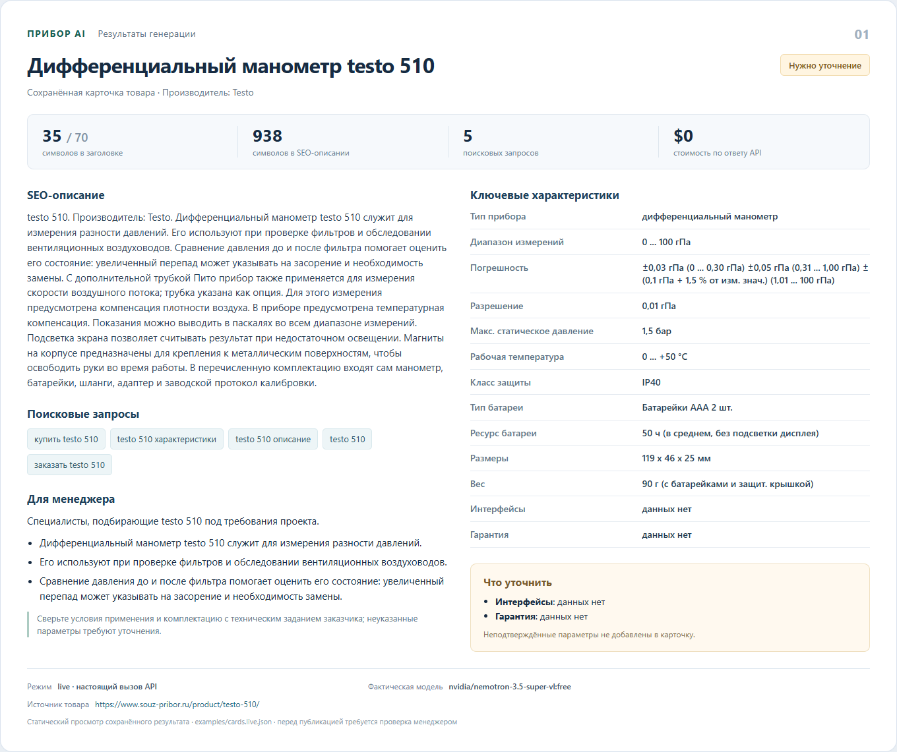
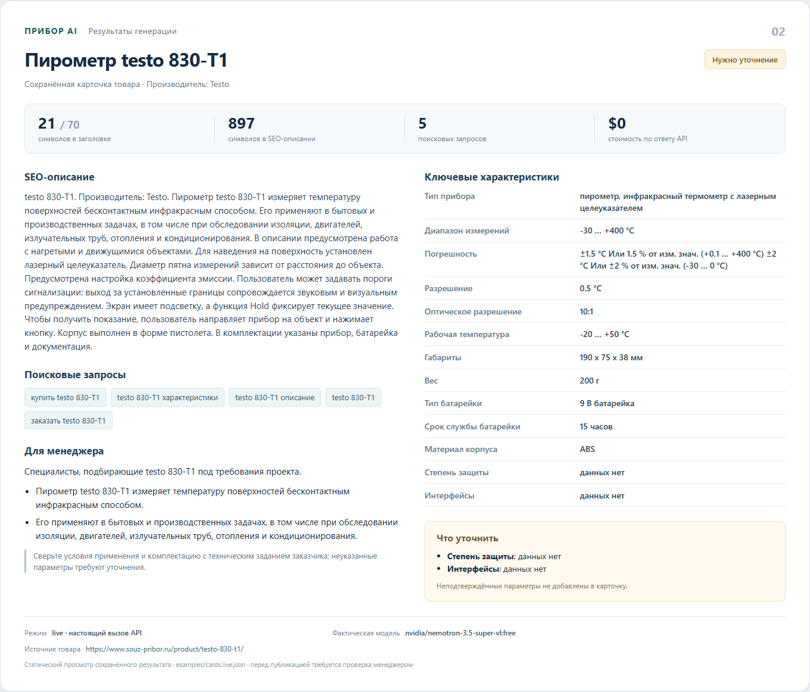

# Прибор AI

Локальный помощник для подготовки черновиков B2B-карточек контрольно-измерительных приборов. Принимает JSON и формирует SEO-заголовок, описание, характеристики, поисковые запросы и блок для менеджера. Использует **бесплатные модели OpenRouter**.

Готовые результаты настоящего API: [две карточки](examples/cards.live.md), [JSON с источниками и метаданными](examples/cards.live.json), [протокол проверки](VALIDATION.md).

## Скриншоты результата

Это снимки статического просмотра сохранённых результатов настоящих API-вызовов. Просмотр не является веб-интерфейсом сервиса.





HTML-просмотр: [examples/result-preview.html](examples/result-preview.html). Скачайте и откройте файл в браузере. Для пересборки из JSON: `python scripts/render_preview.py`.

## Быстрый запуск

Нужен Python 3.10 или новее. Сторонних библиотек для запуска и тестов нет. Команды выполняются из папки с этим README.

```powershell
python --version
Copy-Item .env.example .env
```

Если `.env` уже существует, **не перезаписывайте его**. Создайте ключ в [OpenRouter](https://openrouter.ai/settings/keys) и впишите его в `.env`:

```dotenv
OPENROUTER_API_KEY=ваш_ключ
OPENROUTER_MODEL=openrouter/free
```

Настоящая генерация двух карточек:

```powershell
python -m pribor_ai examples/products.json --output cards.json --markdown cards.md
```

Для Linux/macOS вместо `Copy-Item` используйте `cp`, при необходимости — `python3`. Переменные окружения имеют приоритет над `.env`. Другой конфигурационный файл можно передать через `--env-file`.

Без ключа можно проверить ввод и формат результата локально:

```powershell
python -m pribor_ai examples/products.json --demo --output cards.demo.json --markdown cards.demo.md
```

Режим `--demo` **не вызывает LLM** и явно помечает результат `generation.mode=demo`. Ошибки настоящего API никогда не подменяются демонстрационным результатом.

Установка необязательна. Для отдельной команды `pribor-ai` можно выполнить `python -m pip install -e .`.

## Бесплатность

По умолчанию используется `openrouter/free`: OpenRouter выбирает доступную бесплатную модель, совместимую с JSON Schema. Можно указать конкретную модель с суффиксом `:free`. Другие названия приложение отклоняет **до отправки запроса**. Дополнительно в запросе задаётся нулевая максимальная цена входных/выходных токенов и самого запроса. Платного переключения и платных инструментов нет.

Аккаунт и API-ключ нужны даже для бесплатных моделей. Их доступность и лимиты не гарантированы: при исчерпании квоты приложение сообщает об ошибке, не предлагает автоматическую оплату. Актуальные условия: [free router](https://openrouter.ai/docs/guides/routing/routers/free-router), [лимиты](https://openrouter.ai/docs/api_reference/limits), [ограничение цены](https://openrouter.ai/docs/guides/routing/provider-selection#max-price).

## Входные данные

Можно передать один объект или массив до 20 объектов. Файл — UTF-8, до 1 МБ.

```json
{
  "name": "Название и модель",
  "manufacturer": "Производитель",
  "specs": {
    "Тип прибора": "Тип по источнику",
    "Диапазон измерений": "Значение вместе с единицами и условиями"
  },
  "description": "Описание или фрагмент технического паспорта.",
  "expected_specs": ["Питание", "Интерфейсы"],
  "source": {"product_url": "https://example.com/product"}
}
```

- `name` обязателен. Неверные типы, пустое название, неизвестные поля, дубликаты ключей и некорректный JSON отклоняются до вызова API.
- Значения характеристик — строки: единицы, десятичные разделители и условия не пересчитываются и не сокращаются. Пустая строка или `null` означает отсутствие сведений.
- Пропущенные `manufacturer`, `description`, `specs` и пустые значения попадают в `missing_fields` с пометкой «данных нет».
- `expected_specs` — список нужных для конкретного вида прибора характеристик. Отсутствующие поля этого списка явно отмечаются. Универсального перечня для всех приборов нет: не следует требовать питание от механического манометра.
- `source` — произвольные сведения о происхождении данных; сохраняются в результате, но не отправляются модели и не используются как инструкции.

## Как устроено решение

1. Валидация и нормализация пробелов входного JSON.
2. Каталог фактов: целые предложения описания и пары «характеристика — значение» получают ID.
3. Один вызов OpenRouter на товар. Модель выбирает порядок фактов, ключевые характеристики, предложения о назначении и намерения поисковых запросов. Используется строгая JSON Schema и `require_parameters=true`.
4. Локальная проверка плана: неизвестные ID, неверные категории фактов, дубликаты и лишние поля отклоняются.
5. Сборка карточки только из исходных фактов и фиксированных нейтральных формулировок. Вся сложная погрешность переносится целиком. Никакие свободные технические утверждения модели в результат не попадают.
6. Проверка длины, маркировка пропусков и сохранение JSON/Markdown. `evidence` показывает факты, использованные в SEO-тексте; `generation` содержит фактическую модель и план.

Промпт находится в `pribor_ai/core.py` (`SYSTEM_PROMPT`), схема — рядом (`PLAN_SCHEMA`). Товарные данные отделены от системного промпта и явно объявлены недоверенными. Модель не имеет инструментов и не выполняет инструкции из описаний.

Это **извлекающая генерация**, а не свободный рерайт. LLM принимает редакторские решения, а программа переносит выбранные факты. Компромисс осознанный: для приборов сохранность условий измерения важнее разнообразия рекламного текста. Описание на входе должно быть достоверным и относиться к выбранной модификации.

Заголовок ограничен 70 символами. Для длинного названия выдаётся предупреждение о сокращении. SEO-описание собирается из целых фактов до 1 200 символов. При нехватке выбранных фактов программа добавляет резерв из того же входа; если 800 символов собрать нельзя, результат получает `needs_data`, короткое описание и конкретное предупреждение вместо выдуманных сведений. Это описание карточки, а не короткий HTML meta-description.

Поисковые запросы — 3–5 вариантов по названию модели. Это предложения для страницы, а не подтверждённые частотности из Wordstat. Блок для менеджера содержит общий профиль закупщика и исходные предложения о задачах прибора; конкретные отрасли не додумываются.

## Два товара из задания

- **testo 510** — дифференциальный манометр.
- **testo 830-T1** — пирометр.

[Исходный фид](https://www.souz-pribor.ru/yml/any/feed.xml) содержал 47 978 предложений, но не содержал `description`; его `param` — артикулы и коды. Поэтому данные дополнены из связанных страниц магазина. Подробности и спорные места описаны в [examples/SOURCES.md](examples/SOURCES.md). `examples/products.json` содержит проверенные входы, а `examples/sources/` — исходные XML-предложения.

Редакторские описания во входных данных подготовлены по страницам товара; их нельзя выдавать за сырой текст фида или за ответ LLM. В двух примерах намеренно заданы неизвестные `expected_specs`: эти параметры должны быть уточнены, поэтому даже хороший черновик может иметь статус `needs_data`.

## Ошибки и проверки

```powershell
python -m unittest discover -s tests -v
```

Тесты не требуют ключа и не обращаются к сети. Проверяются входные данные, ограничения плана, сохранность фактов, длины, пропуски, ошибки API, лимиты, повторы, секреты и файловые операции. Реальные результаты и сведения о выполненной проверке находятся в `VALIDATION.md`.

Код завершения `0` означает сформированный результат (в том числе `needs_data`); `2` — ошибка ввода, API или файла. Статус готовности черновика нужно читать в JSON.

При 429, 5xx и сетевых сбоях — максимум три попытки. Таймаут сетевой операции — 45 секунд; это не жесткий предел общей длительности генерации. `Retry-After` соблюдается; при ожидании свыше 30 секунд возвращается просьба повторить позже. Отказ модели, обрезанный ответ и неверный JSON не принимаются. Все карточки формируются до записи: ошибка второго товара не заменит предыдущий файл частичным результатом. Каждый выходной файл заменяется атомарно; пара JSON/Markdown не является общей транзакцией.

Ключ берётся только из окружения или локального `.env`. Он не записывается в результаты и не включается в Git. Тела ошибок провайдера не печатаются. Адрес API фиксирован, перенаправления запрещены. На OpenRouter отправляется каталог фактов, необходимый для генерации; конфиденциальные документы в этом прототипе не используются.

## Ограничения и развитие

- Проверяется соответствие **входным** фактам, а не истинность источника. Ошибки каталога, противоречия и неподходящие фрагменты паспорта требуют редакторской проверки.
- Разделение описания на предложения простое. Сложные таблицы и сокращения лучше предварительно структурировать в `specs`; для XML-фида автоматического обогащения из сайтов нет.
- Нельзя гарантировать правильную редакторскую приоритизацию бесплатной моделью. Исходный фрагмент может быть верным, но неудачно выбранным для раздела «Задачи». Перед публикацией карточку проверяет человек.
- Технические значения не изменяются, но SEO-текст не уникализируется. Следующий этап — проверяемый рерайт с подтверждением каждого утверждения и отдельной оценкой качества, а не отключение проверки фактов.
- Следующие полезные улучшения: профили обязательных полей по типам приборов, явное разрешение противоречий источников, веб-форма с просмотром доказательств, кэш по хешу входа и модели.
- Нет CMS, базы данных, деплоя и автоматической публикации. Бесплатные лимиты подходят для тестового прототипа; обещаний промышленной доступности нет.

## Передача проекта

Репозиторий: [Ezcube/pribor-ai](https://github.com/Ezcube/pribor-ai). Короткое сопроводительное сообщение — в [SUBMISSION.md](SUBMISSION.md).

`.env`, кеши Python и локальная среда исключены из публикации и передаваемого архива. Сервис не публикует карточки автоматически: он сохраняет локальные черновики для проверки менеджером.
